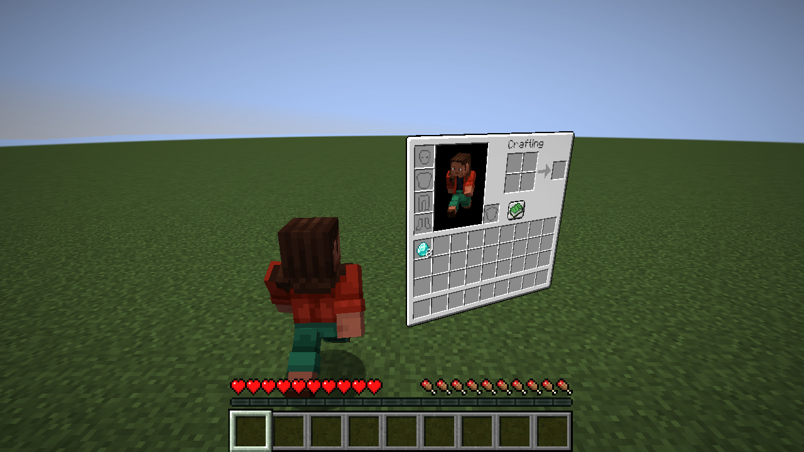
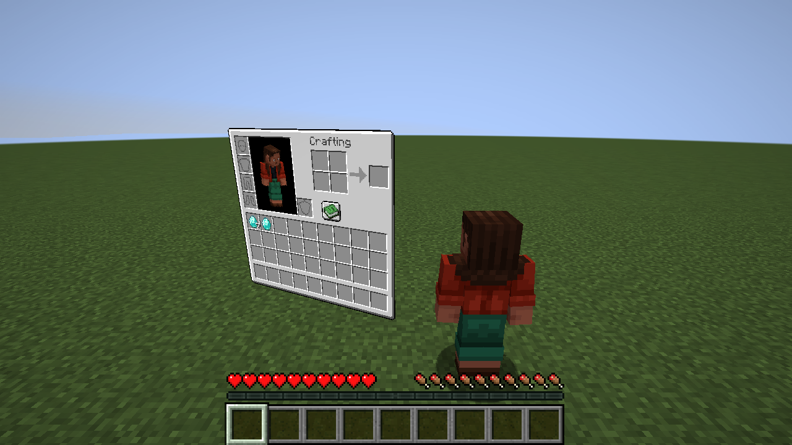
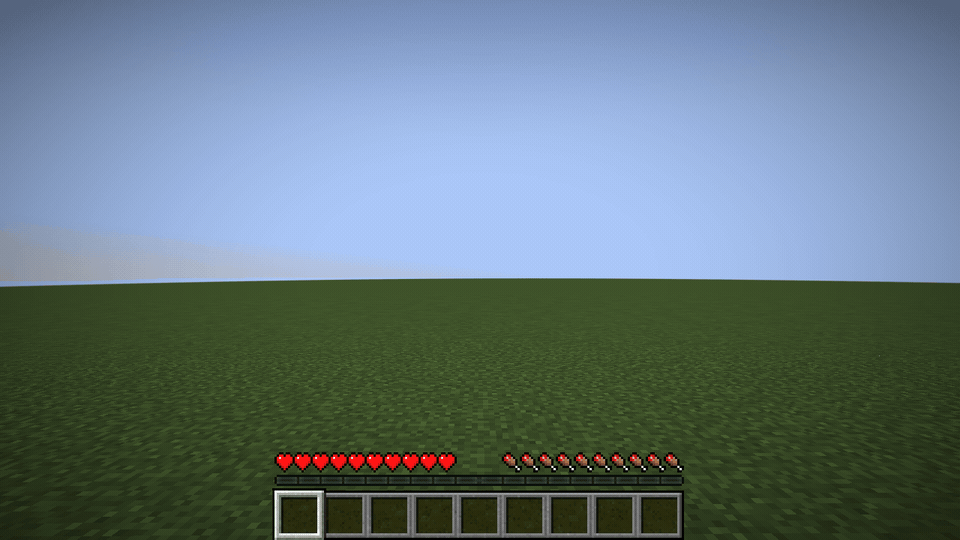
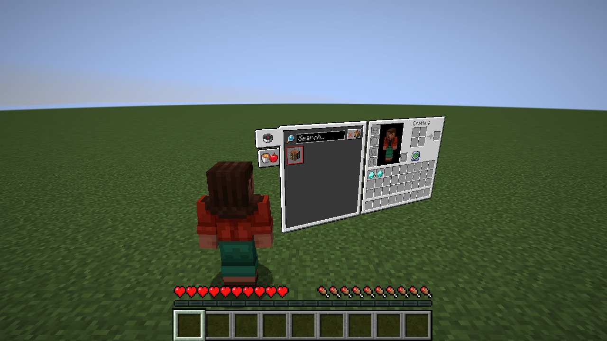
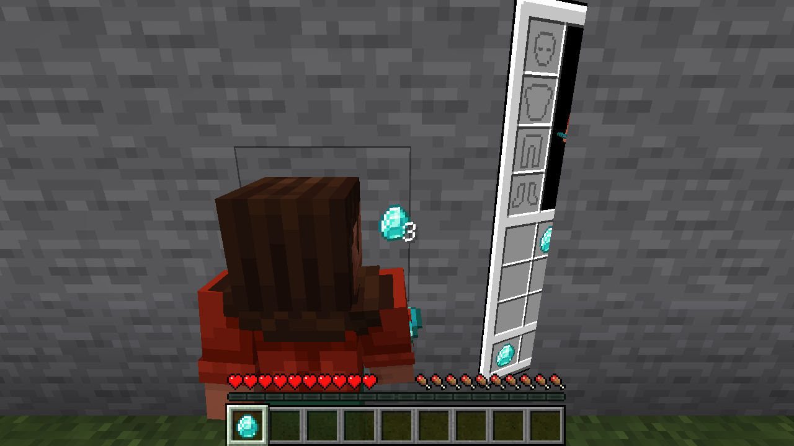

# 世界空间背包验证记录

日期：2026-10-09。Minecraft 1.21.1，Fabric Loader 0.19.5，Fabric API 0.116.17，InvMove 0.9.3，Cloth Config 15.0.140。Windows 11，构建工具使用 Java 25，实际游戏运行于 Java 21。

## 已执行

- `gradlew build` 成功，生成可安装 JAR 与源码 JAR。
- 安装 Mod Menu 11.0.5：独立实际客户端 + 集成服务器，52 项检查通过。
- 不安装 Mod Menu：独立实际客户端 + 集成服务器，51 项检查通过。
- 检查发布 JAR 的客户端环境、前置声明、语言资源、Java 21 字节码（major 65）、重映射后的 Camera 方法选择器。
- 发布 JAR 不包含 smoke 测试、输入模拟或模板 Example mixin。
- `git diff --check` 通过。

详细检查列表保存在 [有 Mod Menu](smoke-with-modmenu.json) 与 [无 Mod Menu](smoke-without-modmenu.json) 的结果文件中。

## 实际客户端检查的行为

- 从第一人称打开背包切入第三人称；面板从玩家前方向侧边展开，关闭时反向收回。默认左侧玩家、右侧面板，左右选项同步交换肩膀与面板。
- 面板绘制于世界三维平面，透视后的左右边缘具有不同的投影高度；移动时面板的位置跟随玩家。
- 开放背包后的第一个游戏 tick 仍然有前进输入，背包保持打开时角色实际移动。
- InvMove 默认模式保持打开前的下蹲状态；配方书搜索框聚焦时禁止移动。
- 原版槽位左键拿取、右键放置、拖拽均分、Shift 快速转移、数字键交换，经集成服务器同步。
- 配方书与背包一起显示在世界面板上，可展开、可搜索。
- 关闭后恢复第一人称、第三人称背面及第三人称正面；快速反复打开关闭、零时长、切换其他屏幕、禁用模组均有检查。
- 窄窗口下保留世界面板，自动缩小面板和侧向距离，并验证面板边缘位于窗口内。
- 近墙时摄像机停在墙前，眼睛到摄像机的路径不穿过墙体。
- 实体方块遮挡面板时，鼠标射线无法点击墙后的区域；在遮挡区域松开鼠标不会丢出手持物品。
- 鼠标经原生 MouseHandler 回调移动到投影后的槽位中心，实际渲染产生正确的 hovered slot，再进行数字键交换。
- 重新加载专用测试资源包后，原版背包贴图资源来自该包。测试包复用原贴图，验证资源覆盖路径，未声称验证所有材质包的外观。
- 创造背包不接管摄像机。
- Mod Menu 通过注册入口发现并打开 Cloth Config 设置页；设置可以保存后读回。

物理按键状态由独立测试 mixin 提供，InvMove 的输入处理、原版背包及集成服务器照常运行。鼠标拿放与拖动使用世界平面的投影坐标调用屏幕事件，再经生产代码中的射线转换交给原版处理；数字键检查使用 MouseHandler 回调移动指针，未直接设置 hovered slot。测试覆盖了行走晃动时的逆投影偏移。

## 视觉证据

更多原始截图位于本地运行目录的 `smoke-evidence/`。这是游戏帧缓冲截图，不是示意图。

## 范围与日志

本轮使用实际开发客户端，未启动发布 JAR 的独立生产环境实例，未执行专用多人服务器、第三方摄像机或修改背包布局模组的联合测试。死亡和断开世界的释放逻辑已经实现，尚无对应自动断言。

成功运行日志中存在 Minecraft 山羊音效缺失、着色器采样器警告，以及开发环境空 main 类目录提示；Gradle 初次配置存在弃用 API 提示。最终两次客户端运行没有 ERROR 或 mixin 应用失败。

自由位置、大小及透明度的实时编辑尚未实现；本轮设置仅提供启停、左右切换和面板/镜头动画时长。遮挡测试检查实体方块的交互阻挡并保留实际画面，未覆盖所有透明方块、光影或第三方渲染器。
